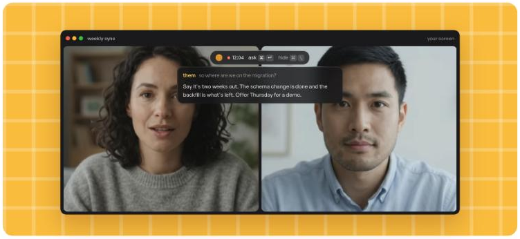

<p align="center">
  
</p>

<h1 align="center">waffle</h1>

<p align="center">
  <b>An AI overlay for your meetings. Free, open source, and it runs on the AI you already pay for.</b>
</p>

<p align="center">
  Press <kbd>⌘</kbd> <kbd>↵</kbd> and Waffle reads your screen and answers on top of whatever you're doing.<br>
  It stays hidden from screen shares and recordings, and it never joins the call.
</p>

<p align="center">
  <a href="https://github.com/KabirK-05/waffle-releases/releases/latest/download/Waffle.dmg"></a>
</p>

<p align="center">
  
  
  
  
</p>

<p align="center">
  
</p>

> [!NOTE]
> The first signed release isn't published yet, so the download button won't work until it is. Until then, [run it from source](#build-it-from-source).

## Why it's free

Waffle has no server and no accounts. Your questions go from your Mac straight to the AI you choose, so there is nothing to charge for.

Bring one of these:

| | |
| --- | --- |
| **A Claude or ChatGPT subscription** | Waffle drives the Claude Code or Codex CLI you're already signed in to. It never touches their login. |
| **An API key** | From Anthropic or OpenAI. Keys are stored encrypted with the macOS keychain. |

## What it does

<table>
  <tr>
    <td width="33%" valign="top">
      <h3>Ask about your screen</h3>
      <kbd>⌘</kbd> <kbd>↵</kbd> captures your display and sends it with your question. The answer streams into the overlay, and follow-ups keep the context.
    </td>
    <td width="33%" valign="top">
      <h3>Listen to the call</h3>
      <kbd>⌘</kbd> <kbd>⇧</kbd> <kbd>L</kbd> starts a live transcript. Your microphone is "Me" and the call's audio is "Them", so it knows who said what.
    </td>
    <td width="33%" valign="top">
      <h3>Notes when you hang up</h3>
      Stop listening and your AI writes a title and a summary. Sessions are saved in History, where you can reread them or resume.
    </td>
  </tr>
  <tr>
    <td width="33%" valign="top">
      <h3>Hidden from screen share</h3>
      Every Waffle window is excluded from shared screens, recordings and screenshots. It's on by default.
    </td>
    <td width="33%" valign="top">
      <h3>No bot in the meeting</h3>
      Waffle listens on your Mac, so it works over any call app and nothing extra shows up on the guest list.
    </td>
    <td width="33%" valign="top">
      <h3>Make it yours</h3>
      Modes with your own context and reference files, suggested follow-ups on <kbd>⌘</kbd> <kbd>1</kbd> to <kbd>⌘</kbd> <kbd>3</kbd>, rebindable shortcuts and a menu-bar icon.
    </td>
  </tr>
</table>

## Your data stays yours

- **Screenshots and audio are never stored.** They are used for the question and then dropped.
- **Transcription can stay on your Mac.** On macOS 26, Apple's speech engine writes the transcript on device.
- **History is local.** Conversations and sessions are saved as text in a SQLite file on your Mac, and you can turn saving off.
- **Keys are encrypted** with the macOS keychain.

## Shortcuts

| Action | Shortcut |
| --- | --- |
| Ask about the screen | <kbd>⌘</kbd> <kbd>↵</kbd> |
| Show or hide the overlay | <kbd>⌘</kbd> <kbd>\\</kbd> |
| Start or stop listening | <kbd>⌘</kbd> <kbd>⇧</kbd> <kbd>L</kbd> |
| Pick a suggested follow-up | <kbd>⌘</kbd> <kbd>1</kbd> to <kbd>⌘</kbd> <kbd>3</kbd> |
| New chat | <kbd>⌘</kbd> <kbd>R</kbd> |
| Move the overlay | <kbd>⌘</kbd> + arrow keys |
| Scroll the answer | <kbd>⌘</kbd> <kbd>⇧</kbd> <kbd>↑</kbd> / <kbd>⌘</kbd> <kbd>⇧</kbd> <kbd>↓</kbd> |

All of them can be changed in Settings → Keyboard shortcuts.

## Get it

**[Download Waffle.dmg](https://github.com/KabirK-05/waffle-releases/releases/latest/download/Waffle.dmg)**, open it, and drag Waffle to Applications. The build is signed and notarized, and it updates itself (Settings → General → Software Update).

| | |
| --- | --- |
| **macOS** | 14 or later, Apple silicon or Intel |
| **System audio in Listen mode** | macOS 14.2 or later |
| **On-device transcription** | macOS 26 |

The first time you ask or listen, macOS asks for Screen Recording, microphone and system audio access. Grant them in System Settings → Privacy & Security, then relaunch Waffle.

## Build it from source

You need Node.js 22 or later and the Xcode command line tools.

```bash
npm install
npm start
```

`npm run dist` builds the DMG. If you maintain releases, see [docs/releasing.md](docs/releasing.md).

<details>
<summary>Permissions in a development build</summary>
<br>
macOS attributes permissions to the app that launched the process, so in a development build the entry in Privacy &amp; Security may be named "Electron" or belong to your terminal app.
</details>

## A note on use

Hiding an assistant from screen shares and recording other people both carry obligations. Only record people who know they are being recorded, and don't use this where outside help isn't allowed.

## License

MIT. See [LICENSE](LICENSE).
